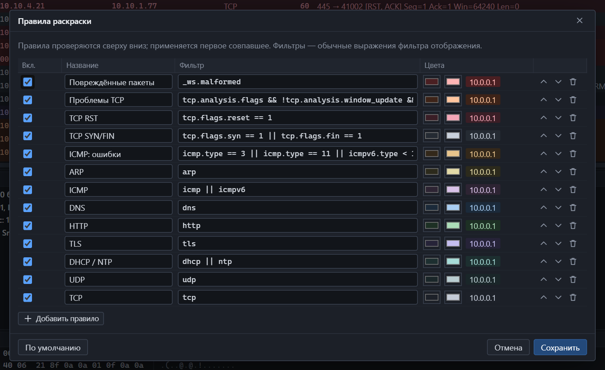

## Правила раскраски

**Правка → Правила раскраски…** или **Инструменты → Правила раскраски…**

Каждое правило — это название, [фильтр](filters.md) и пара цветов: фон и текст. Правила проверяются сверху вниз, применяется первое подошедшее. Поэтому частные правила должны стоять выше общих: «TCP RST» — выше «TCP».

| Элемент | Действие |
|---|---|
| Флажок | Включить или выключить правило |
| Название | Произвольное, для вас |
| Фильтр | Любое выражение фильтра отображения |
| Два образца цвета | Фон и текст; справа — пример строки |
| Стрелки ↑ ↓ | Поднять или опустить правило |
| Корзина | Удалить |
| Добавить правило | Новая строка внизу |
| По умолчанию | Вернуть исходный набор |

Правило с ошибкой в фильтре не применяется, а программа сообщает об этом в строке состояния.

### Правила по умолчанию

| Название | Фильтр |
|---|---|
| Повреждённые пакеты | `_ws.malformed` |
| Проблемы TCP | `tcp.analysis.flags && !tcp.analysis.window_update && !tcp.analysis.keep_alive` |
| TCP RST | `tcp.flags.reset == 1` |
| TCP SYN/FIN | `tcp.flags.syn == 1 or tcp.flags.fin == 1` |
| ICMP: ошибки | `icmp.type == 3 or icmp.type == 11 or icmpv6.type < 128` |
| ARP | `arp` |
| ICMP | `icmp or icmpv6` |
| DNS | `dns` |
| HTTP | `http` |
| TLS | `tls` |
| DHCP / NTP | `dhcp or ntp` |
| UDP | `udp` |
| TCP | `tcp` |

Красные и оранжевые оттенки оставлены для проблем: повреждённых пакетов, ошибок TCP и ICMP.

### Включить и выключить раскраску

Кнопка с палитрой на панели инструментов или **Вид → Раскрашивать список пакетов**. Правила при этом сохраняются.

## Колонки списка

Правая кнопка по заголовку списка пакетов открывает меню колонок.

| Действие | Как |
|---|---|
| Показать или скрыть колонку | Щёлкнуть её в меню |
| Скрыть колонку под указателем | «Скрыть колонку» |
| Изменить ширину | Потянуть границу заголовка |
| Вернуть исходный набор | «Сбросить колонки» |

Какие колонки есть и что в них — в разделе [список пакетов](packet-list.md).

## Формат времени

**Вид → Формат времени** — четыре варианта, см. [окно программы](interface.md).

## Размеры областей

Границы между списком, деталями, байтами и боковой панелью перетаскиваются. Боковую панель можно развернуть на всё окно кнопкой □ в её заголовке.

## Что запоминается

| Настройка | Запоминается |
|---|---|
| Колонки: набор и ширина | Да |
| Правила раскраски и включена ли раскраска | Да |
| Формат времени | Да |
| Размеры областей и ширина боковой панели | Да |
| История фильтров | Последние 30 |
| Недавние файлы | Последние 10 |
| Параметры последнего захвата | Да |
| Автопрокрутка | Да |
| Проверка обновлений при запуске и пропущенная версия | Да |
| Открытая вкладка боковой панели, текущий фильтр | Нет, только до закрытия программы |

Настройки хранятся локально в профиле пользователя Windows. Они не синхронизируются и никуда не отправляются.

## Тема оформления

Сейчас в программе одна тема — тёмная. Светлая тема и английский язык интерфейса запланированы.
