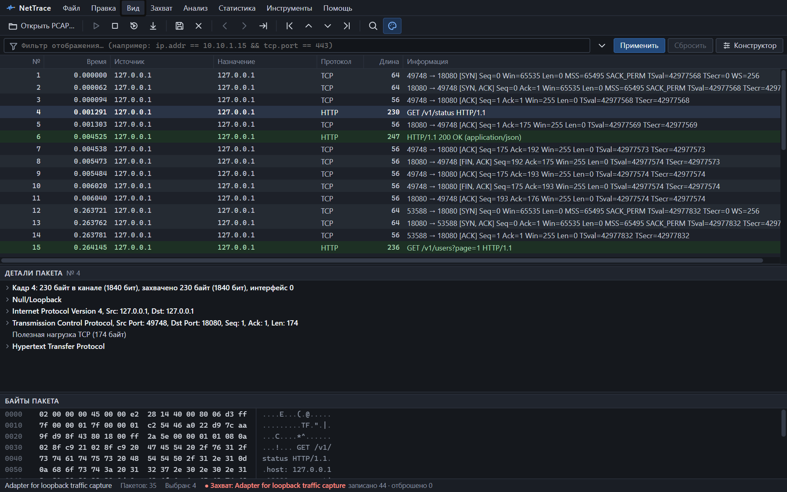
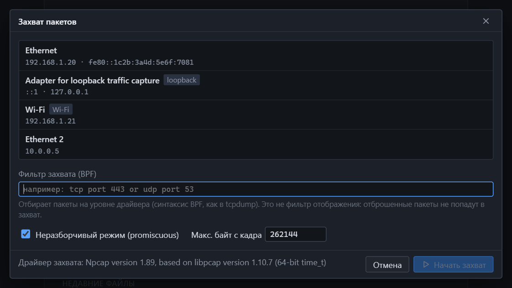

Для захвата нужен драйвер [Npcap](https://npcap.com) — как его поставить, описано в разделе [установка](install.md).


*Захват идёт: пакеты появляются в списке, внизу — счётчики записанных и отброшенных.*

## Начать захват

1. Нажмите <kbd>Ctrl</kbd>+<kbd>K</kbd> или **Захват → Интерфейсы захвата…**
2. Выберите интерфейс.
3. При необходимости задайте фильтр захвата и другие параметры.
4. Нажмите «Начать захват».


*Интерфейсы отсортированы: сначала подключённые, с адресами.*

С тем же интерфейсом можно начать сразу со стартового экрана — щелчком по нему и кнопкой «Начать захват».

## Параметры

| Параметр | Значение |
|---|---|
| Интерфейс | Сетевой адаптер. Метки: `loopback`, `Wi-Fi`, `не подключён` |
| Фильтр захвата (BPF) | Отбирает пакеты на уровне драйвера, синтаксис как в tcpdump |
| Неразборчивый режим | Принимать и чужие кадры, если их доставляет сеть. Включён по умолчанию |
| Макс. байт с кадра | Сколько байт каждого пакета сохранять: от 64 до 262144. По умолчанию — весь пакет |

Параметры последнего захвата запоминаются.

### Фильтр захвата — это не фильтр отображения

| | Фильтр захвата | [Фильтр отображения](filters.md) |
|---|---|---|
| Где задаётся | В диалоге захвата | В строке фильтра |
| Синтаксис | BPF: `tcp port 443` | NetTrace: `tcp.port == 443` |
| Когда работает | До записи пакета | После записи |
| Отброшенное | Теряется навсегда | Остаётся в захвате |

Примеры фильтра захвата:

```text
tcp port 443 or udp port 53
host 10.10.1.15
net 192.168.0.0/16 and not port 22
icmp or arp
```

> **Важно.** Если уменьшить «Макс. байт с кадра», длинные пакеты будут обрезаны. Заголовки останутся, но данные потока — нет: в [содержимом потока](follow.md) такие места помечаются «не захвачено».

## Во время захвата

| Действие | Как |
|---|---|
| Остановить | <kbd>Ctrl</kbd>+<kbd>E</kbd> или кнопка □ |
| Перезапустить с теми же параметрами | <kbd>Ctrl</kbd>+<kbd>R</kbd> |
| Включить или выключить автопрокрутку | Кнопка ↓ или **Захват → Автопрокрутка к новым пакетам** |

Пока идёт захват, работает всё остальное: фильтры, поиск, потоки, статистика. Отфильтрованный список обновляется раз в секунду, панели потоков и последовательности — раз в две секунды.


Строка состояния показывает:

- `● Захват: имя интерфейса` — захват идёт;
- `записано N` — сколько пакетов драйвер передал программе;
- `отброшено N` — сколько драйвер не успел передать. Если число растёт, сузьте фильтр захвата.

## Где хранятся пакеты

Пакеты пишутся во временный файл в папке `%TEMP%\NetTrace`. Он удаляется:

- когда вы закрываете захват или открываете другой файл;
- когда закрывается программа.

Перед этим NetTrace спрашивает, сохранить ли пакеты:

| Ответ | Результат |
|---|---|
| Сохранить… | Захват записывается в выбранный файл PCAP или PCAPNG |
| Не сохранять | Временный файл удаляется |
| Отмена | Захват остаётся открытым |

Чтобы сохранить захват в любой момент после остановки, нажмите <kbd>Ctrl</kbd>+<kbd>S</kbd> без активного фильтра.

## Захват локального трафика

Трафик между программами на одном компьютере (`127.0.0.1`, `::1`) не проходит через обычные адаптеры. Выберите интерфейс с меткой `loopback` — он появляется вместе с Npcap.

## Права доступа

| Ситуация | Что делать |
|---|---|
| Npcap установлен с ограничением «только администраторы» | Запускайте NetTrace от имени администратора или переустановите Npcap без этого флажка |
| Интерфейс «не подключён» | Захват начнётся, но пакетов не будет, пока интерфейс не заработает |
| «Не удалось открыть интерфейс» | См. [решение проблем](troubleshooting.md) |
