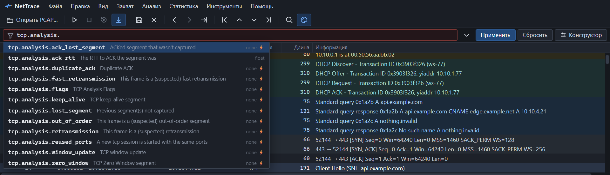
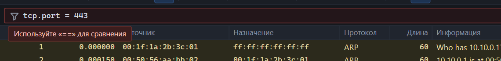
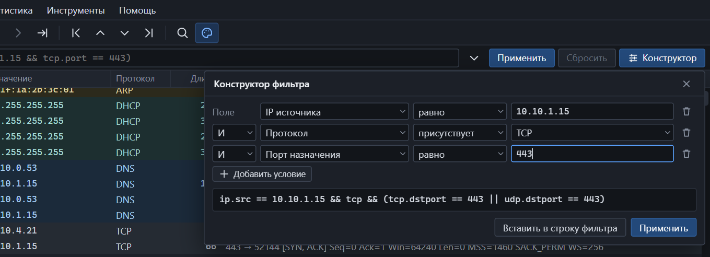

Фильтр ничего не удаляет из захвата — он только скрывает строки. Сбросьте его, и все пакеты вернутся.

## Строка фильтра


*Подсказки при вводе: имя поля, описание и тип.*

| Действие | Как |
|---|---|
| Перейти в строку фильтра | <kbd>Ctrl</kbd>+<kbd>/</kbd> |
| Применить | <kbd>Enter</kbd> или кнопка «Применить» |
| Сбросить | Кнопка «Сбросить» |
| Принять подсказку | <kbd>Tab</kbd>, либо стрелками выбрать и <kbd>Enter</kbd> |
| История | Кнопка ▾ справа от строки — последние 30 выражений |
| Конструктор | Кнопка «Конструктор» |

Выражение проверяется во время набора. Если в нём ошибка, строка подсвечивается красным, а под ней появляется объяснение:



После применения в строке состояния видно, сколько пакетов прошло фильтр и за сколько миллисекунд он отработал.

## Из чего состоит выражение

Простейшее условие — поле, оператор и значение:

```text
tcp.port == 443
```

Одно поле без оператора означает «это поле или этот протокол есть в пакете»:

```text
dns
http.host
tcp.analysis.retransmission
```

Условия соединяются логическими операторами и скобками:

```text
(ip.src == 10.10.1.15 || ip.src == 10.10.1.77) && !arp
```

## Операторы сравнения

| Оператор | Словом | Значение |
|---|---|---|
| `==` | `eq` | Равно |
| `!=` | `ne` | Не равно |
| `>` | `gt` | Больше |
| `>=` | `ge` | Больше или равно |
| `<` | `lt` | Меньше |
| `<=` | `le` | Меньше или равно |
| `contains` | | Содержит подстроку или последовательность байт |
| `in { … }` | | Равно одному из перечисленных значений |

Одиночный `=` не работает — используйте `==`.

## Логические операторы

| Оператор | Словом | Значение | Приоритет |
|---|---|---|---|
| `!` | `not` | НЕ | Высший |
| `&&` | `and` | И | Средний |
| `\|\|` | `or` | ИЛИ | Низший |

Приоритет как в большинстве языков: `a || b && c` читается как `a || (b && c)`. Когда сомневаетесь — ставьте скобки.

## Типы полей и значения

У каждого поля есть тип. От него зависит, какие операторы допустимы и как писать значение.

| Тип | Операторы | Как писать значение | Пример |
|---|---|---|---|
| protocol, наличие | Только наличие | Без значения | `tls`, `tcp.analysis.retransmission` |
| bool | `==` `!=` | `1`, `0`, `true`, `false` | `tcp.flags.syn == 1` |
| uint, int | Все, кроме `contains` | Десятичное или `0x…` | `tcp.port <= 0x1bb` |
| float | Все, кроме `contains` | Число с точкой | `frame.time_relative >= 10.5` |
| string | Все | В кавычках или одним словом | `http.host contains "example"` |
| bytes | `==` `!=` `contains` | Hex через `:` или строка в кавычках | `tcp.payload contains 47:45:54` |
| ipv4 | `==` `!=` | Адрес или подсеть CIDR | `ip.addr == 10.0.0.0/8` |
| ipv6 | `==` `!=` | Адрес или подсеть CIDR | `ipv6.addr == fe80::/64` |
| mac | `==` `!=` | Шесть байт через `:` | `eth.src == 00:1f:1a:2b:3c:01` |

Тип каждого поля указан в [справочнике полей](filter-fields.md) и в подсказках при вводе.

### Строки

- Одно слово можно писать без кавычек: `http.host == api.example.com`.
- Если в значении есть пробелы или спецсимволы — берите в двойные кавычки: `http.user_agent contains "Mozilla/5.0 (Windows"`.
- Сравнение строк учитывает регистр: `"Example"` и `"example"` — разные значения.
- Внутри кавычек работают последовательности `\"`, `\\`, `\n`, `\r`, `\t` и `\xNN`.

### Байты

```text
tcp.payload contains "GET"
tcp.payload contains 47:45:54
udp.payload contains 00:01:00:00
```

Строка в кавычках сравнивается как её байты. В hex-записи разделителями могут быть `:`, `-` или `.`, а можно писать слитно: `474554`.

### Подсети

```text
ip.addr == 192.168.0.0/16
ip.src == 10.10.1.0/24
ipv6.addr == 2001:db8::/32
```

### Перечисления

```text
tcp.port in {80 443 8080}
dns.qry.type in {1, 28}
```

Значения разделяются пробелами или запятыми.

## Поля-псевдонимы

Некоторые поля означают «источник или назначение»:

| Поле | Равносильно |
|---|---|
| `ip.addr` | `ip.src` или `ip.dst` |
| `ipv6.addr` | `ipv6.src` или `ipv6.dst` |
| `eth.addr` | `eth.src` или `eth.dst` |
| `tcp.port` | `tcp.srcport` или `tcp.dstport` |
| `udp.port` | `udp.srcport` или `udp.dstport` |

> **Важно.** `ip.addr != 10.0.0.1` означает «ни источник, ни назначение не равны 10.0.0.1», то есть пакеты, в которых этого адреса нет вообще. В Wireshark такое выражение ведёт себя иначе и считается ловушкой; в NetTrace оно работает так, как читается.

То же правило действует для любого поля, которое встречается в пакете несколько раз: `!=` истинно, только если ни одно значение не равно указанному.

## Поля анализа

NetTrace добавляет поля, которых нет в байтах пакета, — результаты анализа потока:

| Поле | Пакеты |
|---|---|
| `tcp.stream == 8` | Все пакеты TCP-потока номер 8 |
| `udp.stream == 2` | Все пакеты UDP-потока номер 2 |
| `tcp.analysis.flags` | С любой пометкой анализа TCP |
| `tcp.analysis.retransmission` | Повторные передачи |
| `tcp.analysis.fast_retransmission` | Быстрые повторные передачи |
| `tcp.analysis.duplicate_ack` | Дубликаты ACK |
| `tcp.analysis.out_of_order` | Сегменты не по порядку |
| `tcp.analysis.lost_segment` | Перед этим сегментом что-то не захвачено |
| `tcp.analysis.zero_window` | Нулевое окно |
| `_ws.malformed` | Повреждённые пакеты |
| `frame.number`, `frame.len`, `frame.time_relative` | Номер, длина и время пакета |

Что означает каждая пометка — в разделе [потоки и TCP-анализ](streams.md).

## Конструктор фильтра

Если не хочется помнить имена полей, соберите выражение мышью: **Анализ → Конструктор фильтра** или кнопка «Конструктор».


*Три условия, соединённые через И. Внизу — получившееся выражение.*

1. Выберите поле, оператор и значение.
2. «Добавить условие» — ещё одна строка; слева выбирается И или ИЛИ.
3. «Применить» сразу фильтрует список, «Вставить в строку фильтра» — только подставляет выражение.

Конструктор выдаёт обычное выражение, которое можно дописать руками.

## Быстрые и медленные поля

| Вид поля | Как проверяется | Скорость |
|---|---|---|
| Быстрое (по индексу) | По данным, собранным при индексировании: адреса, порты, протоколы, потоки, флаги TCP | Миллионы пакетов в секунду |
| Требует разбора пакета | Каждый пакет читается с диска и разбирается | Медленнее в десятки раз |

Чтобы ускорить медленный фильтр, добавьте быстрое условие через `&&`: в `tcp.port == 443 && tls.handshake.extensions_server_name contains "example"` разбираться будут только пакеты с портом 443.

Вид каждого поля указан в [справочнике](filter-fields.md).

## Сообщения об ошибках

| Сообщение | Причина | Как исправить |
|---|---|---|
| Используйте «==» для сравнения | Одиночный `=` | `tcp.port == 443` |
| Неизвестное поле «…» | Опечатка в имени поля | Выберите поле из подсказки |
| Значение не подходит к типу поля | Например, текст вместо числа | Проверьте тип поля |
| Оператор не применим к полю типа … | Например, `>` для IP-адреса или `contains` для числа | См. таблицу типов выше |
| Не закрыта скобка, Не закрыта кавычка | Непарные `(` или `"` | Закройте |
| Выражение оборвано, Ожидается значение | Выражение не дописано | Допишите значение |
| Слишком сложный фильтр | Больше 4096 условий или 64 уровней скобок | Используйте `in { … }` или подсети |

## Отличия от Wireshark

- Нет операторов `matches` (регулярные выражения), `~`, срезов `[n:m]` и функций.
- `!=` для полей-псевдонимов работает по смыслу — см. выше.
- Набор полей меньше: только [поддерживаемые протоколы](protocols.md).
- Имена полей совпадают с Wireshark там, где поле есть в обеих программах.
