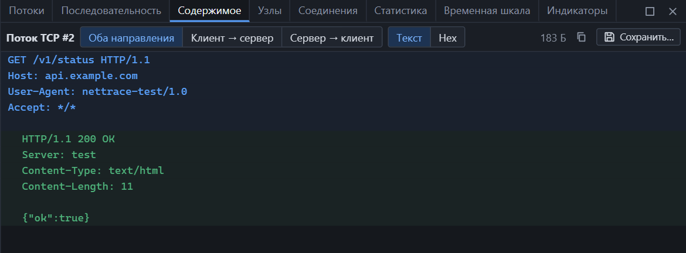
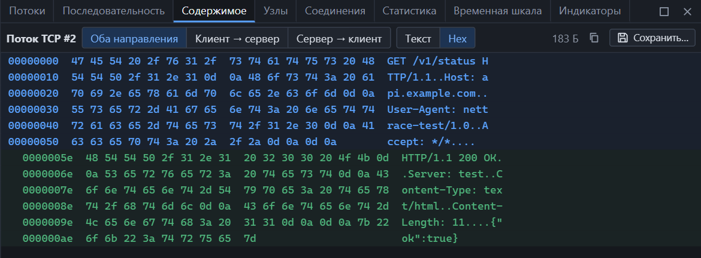

> **Примечание.** Функция появится в версии 1.1.0. В версии 1.0.1 её ещё нет.

Панель собирает полезную нагрузку всех пакетов потока в один непрерывный текст — так, как его видели приложения на обеих сторонах.

*HTTP-поток: синим — запрос клиента, зелёным с отступом — ответ сервера.*

## Открыть

- Контекстное меню пакета или поля → «Содержимое потока»;
- кнопка «Содержимое» в карточке [потока](streams.md);
- **Анализ → Содержимое потока**;
- контекстное меню в панелях «Потоки» и «Соединения».

## Что делает сборка

TCP-сегменты приходят не обязательно по порядку и могут повторяться. NetTrace восстанавливает исходный поток байт:

| Ситуация | Что происходит |
|---|---|
| Повторная передача | Дубликат отбрасывается |
| Сегменты перекрываются | Уже показанные байты не повторяются |
| Сегмент пришёл раньше предыдущего | Ждёт своей очереди и встаёт на место |
| Сегмент потерян | На его месте строка `[потеряно N: эти сегменты не попали в захват]` |
| Пакет обрезан длиной захвата | Строка `[не захвачено N: пакет обрезан длиной захвата]` |

Для UDP датаграммы показываются по порядку появления, как есть.

## Управление

| Элемент | Действие |
|---|---|
| Оба направления / Клиент → сервер / Сервер → клиент | Что показывать |
| Текст / Hex | Вид данных |
| Значок копирования | Копирует всё загруженное в буфер обмена |
| Сохранить… | Записывает данные потока в файл |
| Щелчок по строке | Выбирает в списке пакет, из которого эта строка |

Направления различаются цветом и отступом: строки сервера сдвинуты вправо. Подсказка при наведении показывает номер пакета и направление.

## Текстовый вид

Байты показываются как текст в кодировке UTF-8. Всё, что не является видимым символом, заменяется обозначением:

| В данных | На экране |
|---|---|
| Управляющий байт | `\x00`, `\x1b` |
| Байт, недопустимый в UTF-8 | `\xff` |
| Одиночный возврат каретки | `\r` |
| Невидимые и переворачивающие текст символы Unicode | `\u{202E}`, `\u{200B}` |

Это защита от подмены: данные из сети не могут выглядеть на экране иначе, чем они есть на самом деле.

Строки длиннее 256 символов переносятся.

## Hex-вид

По 16 байт в строке: смещение, байты, ASCII. Смещение — позиция в показанных данных, а не в пакете.

## Сохранение в файл

«Сохранить…» записывает данные выбранного направления в двоичный файл — без заголовков пакетов, в порядке передачи. Так можно извлечь переданный файл или тело ответа.

- Сохранение доступно после окончания индексирования.
- Потерянные и обрезанные участки в файл не попадают. Если такие были, программа сообщит, сколько байт отсутствует: файл в этом случае неполный.

## Большие потоки

Панель загружает поток частями по мере прокрутки и держит в памяти не больше 8 МБ или 200 тысяч строк. Когда предел достигнут:

- **Следующая часть** — показать данные дальше;
- **С начала** — вернуться к началу потока.

Чтобы получить поток целиком, сохраните его в файл — на сохранение предел не действует.

## Во время живого захвата

Панель дополняется по мере поступления пакетов. Внизу видно «Ожидание новых данных захвата…», пока новых пакетов потока нет.

## Чего панель не делает

- Не расшифровывает TLS: для зашифрованных потоков видны байты записей TLS, а не данные приложения.
- Не распаковывает gzip и не разбирает HTTP chunked — показываются байты как они переданы.
- Не выполняет и не открывает содержимое.
