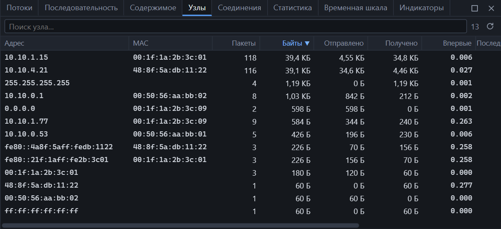
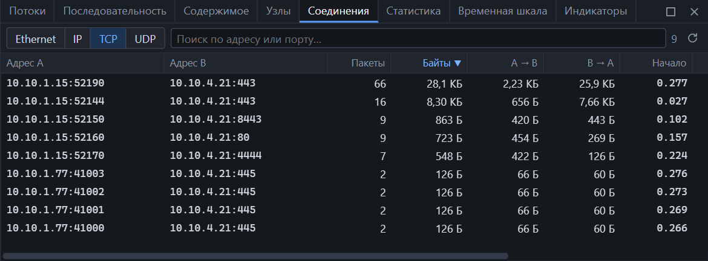

## Узлы

**Статистика → Узлы.** По строке на каждый адрес, встреченный в захвате.

| Колонка | Значение |
|---|---|
| Адрес | IPv4, IPv6 или MAC — для кадров без IP |
| MAC | Аппаратный адрес, с которого приходили пакеты этого узла |
| Пакеты, Байты | Всего с участием узла |
| Отправлено, Получено | Байты по направлениям |
| Протоколы | Протоколы, замеченные в пакетах узла |
| Впервые, Последний раз | Время первого и последнего пакета от начала захвата |

| Действие | Как |
|---|---|
| Найти узел | Поле поиска над таблицей |
| Отсортировать | Щелчок по заголовку |
| Показать пакеты узла | Двойной щелчок или <kbd>Enter</kbd> |
| Только исходящие или входящие | Контекстное меню → «Фильтр: источник», «Фильтр: назначение» |
| Добавить к текущему фильтру или исключить | Контекстное меню → «…и выбранное», «Исключить» |
| Скопировать адрес или фильтр | Контекстное меню |

### Почему у нескольких адресов один MAC

MAC в таблице — это адрес, с которого кадр пришёл в точку захвата. Для узлов за маршрутизатором это MAC маршрутизатора. Поэтому один MAC у многих IP — признак шлюза, а не ошибка.

### Особые адреса

| Адрес | Что это |
|---|---|
| `255.255.255.255`, `ff:ff:ff:ff:ff:ff` | Широковещательные |
| `0.0.0.0` | Узел без адреса — обычно DHCP-клиент до получения адреса |
| `224.0.0.0/4`, `ff00::/8` | Групповая рассылка |
| `fe80::/10` | IPv6 link-local |

## Соединения

**Статистика → Соединения.** Пары участников и объём обмена между ними.

Переключатель задаёт уровень:

| Уровень | Что считается одной строкой |
|---|---|
| Ethernet | Пара MAC-адресов |
| IP | Пара IP-адресов |
| TCP | Пара «адрес и порт» — совпадает с TCP-потоком |
| UDP | Пара «адрес и порт» — совпадает с UDP-потоком |

| Колонка | Значение |
|---|---|
| Адрес A, Адрес B | Участники; для TCP и UDP — с портами |
| Пакеты, Байты | Всего между ними |
| A → B, B → A | Байты по направлениям |
| Начало, Конец | Время первого и последнего пакета |
| Длительность | Разница между ними |
| Состояние | Для TCP — [состояние соединения](streams.md) |

| Действие | Как |
|---|---|
| Найти соединение | Поиск по адресу или порту |
| Показать пакеты соединения | Двойной щелчок или <kbd>Enter</kbd> |
| Открыть поток, содержимое, последовательность | Контекстное меню — для вкладок TCP и UDP |
| Дополнить текущий фильтр | Контекстное меню |

## Как этим пользоваться

| Вопрос | Где смотреть |
|---|---|
| Кто передал больше всего данных | Узлы, сортировка по «Байты» или «Отправлено» |
| С кем общался узел | Соединения → IP, поиск по его адресу |
| Какие порты открывал узел | Соединения → TCP, поиск по адресу |
| Самые долгие соединения | Соединения → TCP, сортировка по «Длительность» |
| Несимметричный обмен (выгрузка данных) | Сравните «A → B» и «B → A» |

## Большие захваты

Таблицы не загружаются целиком: движок сортирует и отдаёт только видимые строки. Узлы и соединения не ограничены по числу — их может быть миллионы. Подробности — в разделе [пределы](limits.md).
