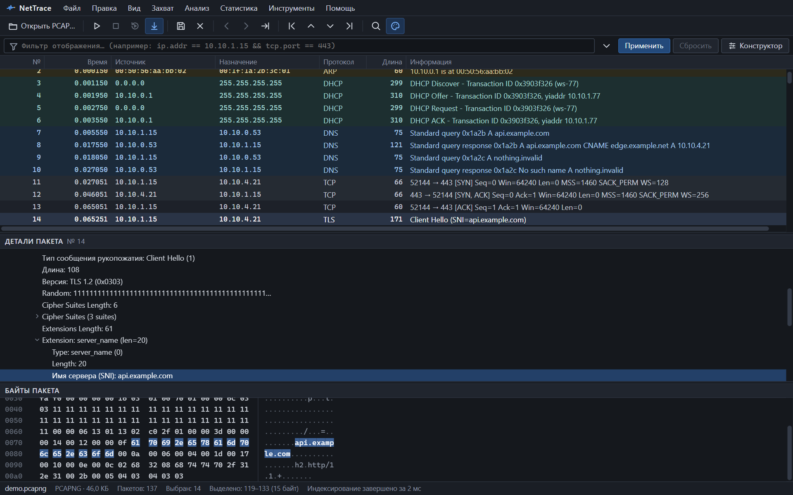

*Главное окно: список пакетов, детали выбранного пакета и его байты.*

## Что умеет

- **Файлы и захват.** PCAP и PCAPNG любого размера; живой захват с интерфейса через Npcap.
- **Разбор протоколов.** Ethernet, VLAN, ARP, IPv4, IPv6, ICMP, TCP, UDP, DNS, DHCP, HTTP/1.x, TLS (SNI, сертификаты), NTP — [полный список](protocols.md).
- **Фильтры.** Язык выражений в стиле Wireshark: `ip.addr == 10.10.1.15 && tcp.port == 443`. 301 поле, подсказки при вводе, визуальный конструктор.
- **Потоки.** TCP- и UDP-потоки с анализом: рукопожатие, RTT, ретрансмиссии, потери, нулевое окно. Диаграмма последовательности и содержимое потока.
- **Статистика.** Узлы, соединения, иерархия протоколов, I/O-график, длины пакетов, временная шкала событий.
- **Индикаторы.** Объективные наблюдения по захвату — без вердиктов и догадок.

NetTrace показывает факты и не делает выводов. Он не выполняет содержимое пакетов, не открывает ссылки из них и не отправляет ваши данные в сеть.

## С чего начать

- [**Установка**](install.md) — скачать, поставить, включить живой захват.
- [**Быстрый старт**](quick-start.md) — от открытия файла до нужного пакета за пять шагов.
- [**Фильтры**](filters.md) — синтаксис, операторы, типы значений.
- [**Готовые фильтры**](filter-recipes.md) — выражения под типовые задачи.
- [**Потоки и TCP-анализ**](streams.md) — что значит каждый счётчик и флаг.
- [**Решение проблем**](troubleshooting.md) — захват недоступен, файл не открывается и другое.

## Коротко о программе

| | |
|---|---|
| Платформа | Windows 10 и 11, x64. Из исходников собирается также под Linux и macOS |
| Текущая версия | [последний релиз](https://github.com/Focusniks/NetTrace-desktop/releases/latest) |
| Язык интерфейса | Русский |
| Живой захват | Нужен драйвер [Npcap](https://npcap.com) |
| Сеть | Только проверка обновлений на GitHub; её можно отключить |
| Лицензия | MIT или Apache 2.0 |
| Исходный код | [github.com/Focusniks/NetTrace-desktop](https://github.com/Focusniks/NetTrace-desktop) |
