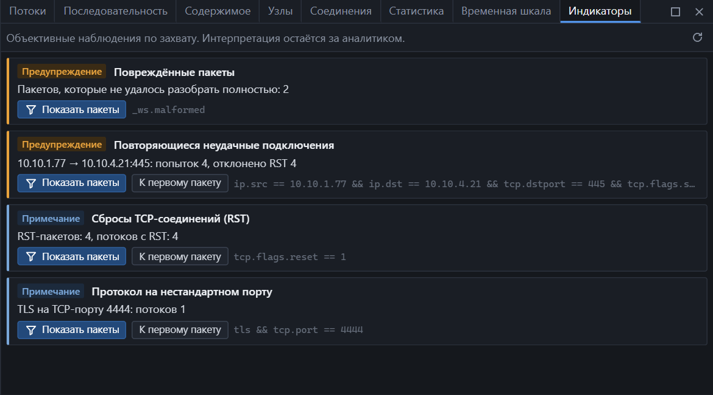

Открывается из меню **Анализ → Индикаторы** или **Вид → Индикаторы**.

## Что это и чем не является

Индикатор — это факт, посчитанный по захвату: «попыток 4, отклонено RST 4». NetTrace не называет его атакой, сканированием или сбоем. Что он означает в вашей сети, решаете вы.

У каждого индикатора есть:

- **важность** — Примечание, Предупреждение или Ошибка;
- **факты** — числа и участники;
- **фильтр** — выражение, которое показывает относящиеся к нему пакеты.

| Кнопка | Действие |
|---|---|
| Показать пакеты | Применяет фильтр индикатора |
| К первому пакету | Переходит к первому относящемуся пакету |
| Обновить | Пересчитывает список, например во время захвата |

## Список индикаторов

| Индикатор | Когда появляется | Важность |
|---|---|---|
| Высокая доля TCP-ретрансмиссий | В потоке не меньше 10 повторных передач, и это не меньше 2% его сегментов с данными | Предупреждение |
| Повторяющиеся неудачные подключения | Не меньше 3 попыток с одного адреса на один адрес и порт остались без установленного соединения | Предупреждение |
| Повреждённые пакеты | Хотя бы один пакет не разобрался до конца | Предупреждение |
| Сбросы TCP-соединений (RST) | В захвате есть пакеты RST | Примечание |
| Нулевое окно TCP | В потоке есть хотя бы один сегмент с окном 0 | Примечание |
| Большое количество соединений | Узел начал не меньше 100 TCP-соединений или обратился не меньше чем к 50 разным портам | Примечание |
| Большое количество DNS-запросов | Узел отправил не меньше 200 DNS-запросов | Примечание |
| Крупный поток данных | В одном потоке в одну из сторон передано не меньше 50 МБ | Примечание |
| Протокол на нестандартном порту | TLS или HTTP распознан по содержимому на порту, который обычно для него не используется | Примечание |

Пороги зашиты в программу и не настраиваются. Индикаторов одного вида показывается не больше 200, чтобы список оставался читаемым.

## Что показывают факты

| Индикатор | Факты |
|---|---|
| Высокая доля TCP-ретрансмиссий | Номер потока, участники, число повторов из числа сегментов, процент |
| Нулевое окно TCP | Поток, участники, число сегментов с нулевым окном |
| Повторяющиеся неудачные подключения | Клиент → сервер и порт, число попыток, сколько отклонено RST |
| Сбросы TCP-соединений | Число RST-пакетов и потоков с RST |
| Большое количество соединений | Узел, число начатых соединений, разных адресов и портов назначения |
| Большое количество DNS-запросов | Узел, число запросов и разных имён |
| Крупный поток данных | Поток, участники, сколько отправил клиент и сколько сервер |
| Протокол на нестандартном порту | Протокол, порт, число потоков |
| Повреждённые пакеты | Число пакетов |

## Возможные причины

Таблица ниже — не выводы программы, а подсказка, с чего начать проверку.

| Индикатор | Что стоит проверить |
|---|---|
| Высокая доля ретрансмиссий | Потери на линии, перегрузку, плохой Wi-Fi; не сделан ли захват с пропусками |
| Нулевое окно | Не тормозит ли приложение-получатель; хватает ли ему памяти и диска |
| Неудачные подключения | Работает ли сервис, не закрыт ли порт межсетевым экраном, правильный ли адрес в настройках клиента |
| Сбросы RST | Кто сбросил и на каком этапе — см. [диаграмму последовательности](sequence.md) |
| Много соединений | Это ожидаемая нагрузка, проверка доступности или перебор |
| Много DNS-запросов | Нет ли зацикливания, неверного суффикса поиска, отсутствия кэша |
| Крупный поток | Ожидаема ли такая передача и в каком направлении шли данные |
| Нестандартный порт | Это настройка сервиса или попытка обойти ограничения |
| Повреждённые пакеты | Не обрезан ли захват, не повреждён ли файл |

## Ограничения

- Индикаторы считаются по всему захвату и не зависят от фильтра отображения.
- Во время живого захвата список не обновляется сам — нажмите «Обновить».
- Отсутствие индикаторов не означает, что проблем нет: проверяются только перечисленные признаки.
