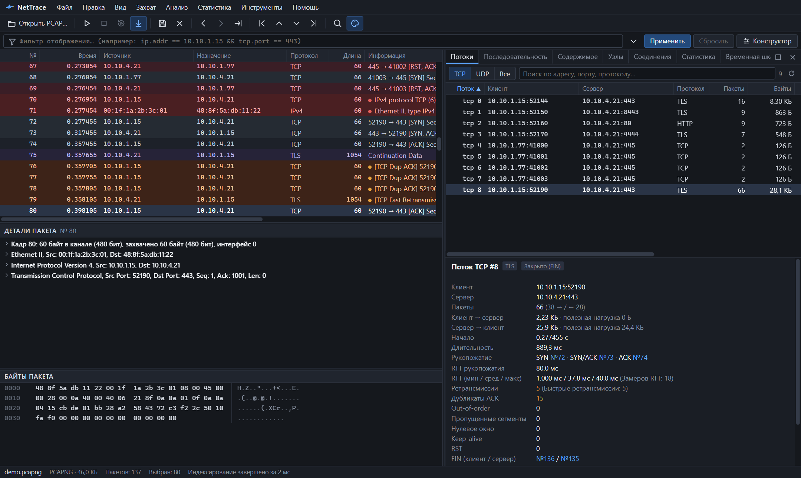
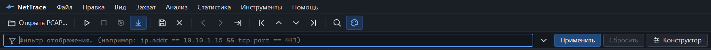
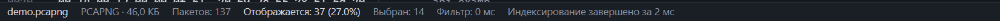
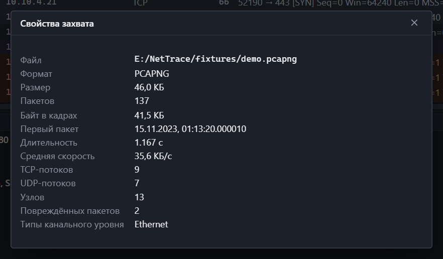
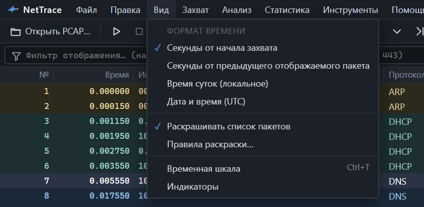

*Слева — список, детали и байты. Справа — боковая панель инструментов.*

## Области окна

| Область | Что в ней |
|---|---|
| Меню | Все команды программы |
| Панель инструментов | Открытие, захват, сохранение, навигация, поиск, раскраска |
| Строка фильтра | [Фильтр отображения](filters.md), история, конструктор |
| [Список пакетов](packet-list.md) | По строке на пакет |
| [Детали пакета](packet-details.md) | Дерево протоколов выбранного пакета |
| Байты пакета | Hex-дамп выбранного пакета |
| Боковая панель | Потоки, последовательность, содержимое, узлы, соединения, статистика, шкала, индикаторы |
| Строка состояния | Файл, число пакетов, фильтр, выбор, индексирование, захват |

Границы между областями перетаскиваются мышью. Размеры запоминаются.

## Панель инструментов

Слева направо:

| Кнопка | Действие | Клавиши |
|---|---|---|
| Открыть PCAP… | Открыть файл захвата | <kbd>Ctrl</kbd>+<kbd>O</kbd> |
| ▷ | Начать захват | <kbd>Ctrl</kbd>+<kbd>E</kbd> |
| □ | Остановить захват | <kbd>Ctrl</kbd>+<kbd>E</kbd> |
| ↻ | Перезапустить захват с теми же параметрами | <kbd>Ctrl</kbd>+<kbd>R</kbd> |
| ↓ | Автопрокрутка к новым пакетам | |
| Дискета | Сохранить отображаемые пакеты | <kbd>Ctrl</kbd>+<kbd>S</kbd> |
| ✕ | Закрыть файл | <kbd>Ctrl</kbd>+<kbd>W</kbd> |
| ‹ › | Назад и вперёд по истории выбора | <kbd>Alt</kbd>+<kbd>←</kbd>, <kbd>Alt</kbd>+<kbd>→</kbd> |
| →\| | Перейти к пакету по номеру | <kbd>Ctrl</kbd>+<kbd>G</kbd> |
| \|‹ ‹ › ›\| | Первый, предыдущий, следующий, последний пакет | <kbd>Ctrl</kbd>+<kbd>Home</kbd>, <kbd>↑</kbd>, <kbd>↓</kbd>, <kbd>Ctrl</kbd>+<kbd>End</kbd> |
| Лупа | Найти пакет | <kbd>Ctrl</kbd>+<kbd>F</kbd> |
| Палитра | Включить или выключить раскраску | |

## Меню

| Меню | Команды |
|---|---|
| Файл | Открыть, недавние файлы, сохранить отображаемые пакеты, свойства захвата, закрыть |
| Правка | Найти пакет, перейти к пакету, правила раскраски |
| Вид | Формат времени, раскраска, временная шкала, индикаторы |
| Захват | Интерфейсы, начать, остановить, перезапустить, автопрокрутка |
| Анализ | Применить и сбросить фильтр, конструктор, поток, содержимое, последовательность, индикаторы |
| Статистика | Свойства захвата, иерархия протоколов, соединения, узлы, потоки, временная шкала |
| Инструменты | Правила раскраски, справочник полей фильтра |
| Помощь | Сочетания клавиш, справочник полей, обновления, о программе |

## Боковая панель

Открывается из меню «Статистика» и «Анализ», из контекстных меню и клавишей <kbd>Enter</kbd> на пакете.

| Вкладка | Раздел |
|---|---|
| Потоки | [Потоки и TCP-анализ](streams.md) |
| Последовательность | [Диаграмма последовательности](sequence.md) |
| Содержимое | [Содержимое потока](follow.md) |
| Узлы, Соединения | [Узлы и соединения](hosts.md) |
| Статистика | [Статистика](statistics.md) |
| Временная шкала | [Временная шкала](timeline.md) |
| Индикаторы | [Индикаторы](indicators.md) |

Кнопки в правом углу панели:

- **□** — развернуть панель на всё окно; повторное нажатие возвращает размер;
- **✕** — закрыть панель.

Щелчок по пакету внутри развёрнутой панели не сворачивает её. Ширину панели меняет граница слева.

## Строка состояния

| Поле | Значение |
|---|---|
| Имя файла | Открытый файл или интерфейс захвата |
| Формат и размер | PCAP или PCAPNG, размер на диске |
| Пакетов | Всего пакетов в захвате |
| Отображается | Сколько пакетов прошло фильтр и какая это доля |
| Выбран | Номер выбранного пакета |
| Выделено | Диапазон байт выбранного поля |
| Фильтр | Время применения фильтра |
| Индексирование | Прогресс или время, за которое файл проиндексирован |

Во время захвата здесь же видно имя интерфейса и счётчики «записано» и «отброшено».

## Свойства захвата

**Файл → Свойства захвата** показывает сводку: путь, формат, размер, число пакетов и байт, время первого пакета, длительность, среднюю скорость, число TCP- и UDP-потоков, узлов, повреждённых пакетов и типы канального уровня.

## Формат времени

**Вид → Формат времени** задаёт, что показывает колонка «Время»:

| Формат | Пример | Когда удобен |
|---|---|---|
| Секунды от начала захвата | `0.065251` | По умолчанию |
| Секунды от предыдущего отображаемого пакета | `0.000200` | Паузы и задержки между пакетами |
| Время суток (локальное) | `14:03:27.120455` | Сопоставление с логами |
| Дата и время (UTC) | `2026-10-01 11:03:27.120455` | Сопоставление между часовыми поясами |
