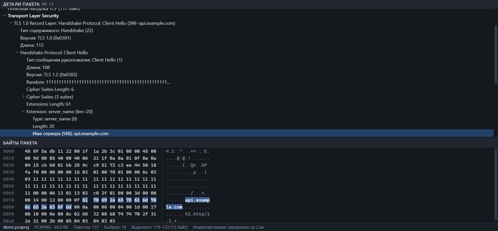
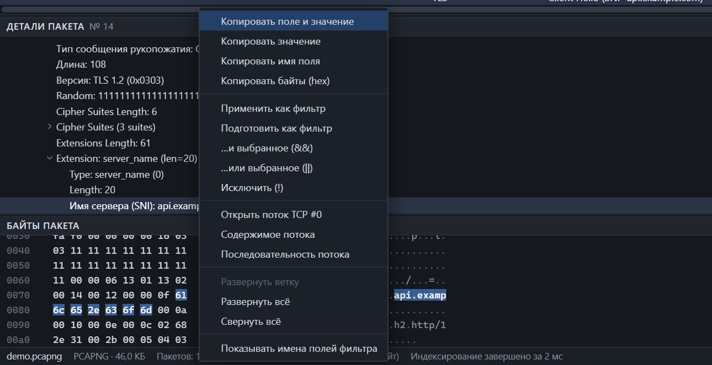

*Выбрано поле «Имя сервера (SNI)» — его 15 байт подсвечены в дампе.*

## Дерево протоколов

Каждый уровень пакета — узел дерева: кадр, канальный уровень, сетевой, транспортный, прикладной. Внутри — поля протокола.

| Действие | Как |
|---|---|
| Развернуть, свернуть узел | Щелчок по стрелке или <kbd>→</kbd>, <kbd>←</kbd> |
| Перейти между полями | <kbd>↑</kbd>, <kbd>↓</kbd> |
| Развернуть ветку, всё, свернуть всё | Контекстное меню |
| Показать имена полей фильтра | Контекстное меню → «Показывать имена полей фильтра» |

Раскрытые узлы запоминаются: при переходе к другому пакету того же вида дерево остаётся раскрытым так же.

### Строки в квадратных скобках

Строки вида `[Анализ SEQ/ACK]` или `[TCP: повторная передача]` — это не байты пакета, а выводы NetTrace из соседних пакетов потока. У них нет диапазона байт, но по ним можно фильтровать: например, `tcp.analysis.retransmission`.

### Служебные пометки

| Пометка | Значение |
|---|---|
| `[Повреждённый пакет: …]` | Разбор остановился: данные не соответствуют формату протокола. Указано смещение |
| `[Сообщение … неполное в этом пакете: не собрано]` | Сообщение протокола продолжается в следующем сегменте TCP |
| `[Запись продолжается в следующем сегменте]` | То же для записи TLS |
| `Полезная нагрузка TCP (N байт, захвачено M)` | Пакет обрезан длиной захвата |

## Байты пакета

Слева — смещение, в середине — байты в hex, справа — они же в виде ASCII. Непечатаемые байты показаны точками.

- Щелчок по полю в дереве подсвечивает его байты.
- Щелчок по байту выбирает в дереве самое глубокое поле, которому он принадлежит.
- Диапазон выбранного поля показан в строке состояния: `Выделено: 119–133 (15 байт)`.

## Контекстное меню поля

| Пункт | Что копирует или делает |
|---|---|
| Копировать поле и значение | `Имя сервера (SNI): api.example.com` |
| Копировать значение | `api.example.com` |
| Копировать имя поля | `tls.handshake.extensions_server_name` |
| Копировать байты (hex) | Байты поля в hex |
| Применить как фильтр | `tls.handshake.extensions_server_name == api.example.com` — и сразу применяет |
| Подготовить как фильтр | То же, но только вставляет в строку фильтра |
| …и выбранное, …или выбранное, Исключить | Дополняет текущий фильтр |
| Открыть поток, Содержимое, Последовательность | Переходят к потоку пакета |

Так удобнее всего строить фильтры: не нужно помнить имя поля — щёлкните по нему правой кнопкой.

## Имена полей фильтра

Включите «Показывать имена полей фильтра» в контекстном меню дерева — рядом с каждым полем появится его имя для фильтра, например `ip.ttl` или `dns.qry.name`. Полный список — в [справочнике полей](filter-fields.md).

## Что NetTrace не делает с содержимым

- Не выполняет содержимое пакетов.
- Не открывает ссылки и адреса из пакетов.
- Не расшифровывает TLS: видны рукопожатие, SNI, сертификаты, но не данные приложения.
