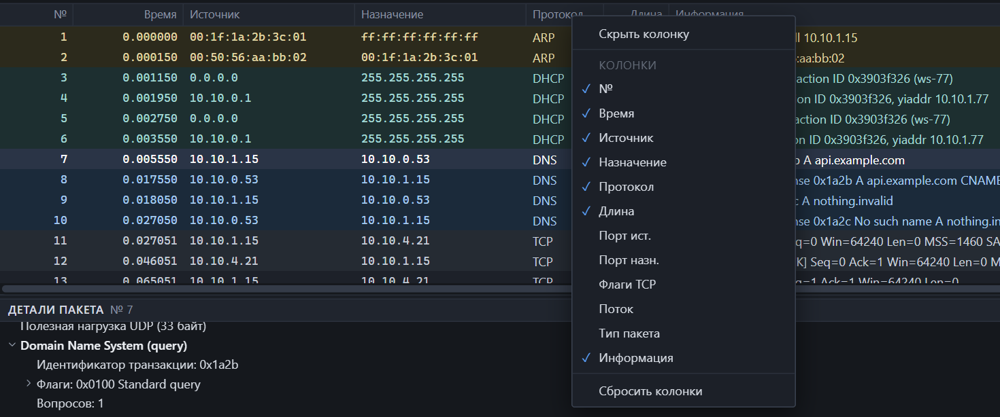
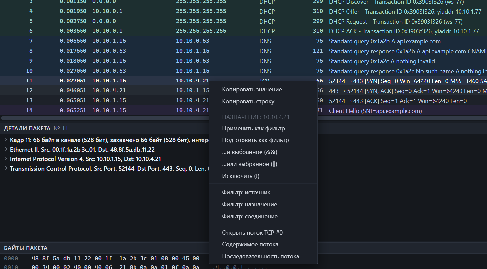

## Колонки

| Колонка | Содержимое | По умолчанию |
|---|---|---|
| № | Порядковый номер пакета в захвате, с единицы | Видна |
| Время | В выбранном [формате времени](interface.md) | Видна |
| Источник | IP-адрес, а если IP нет — MAC | Видна |
| Назначение | То же для получателя | Видна |
| Протокол | Самый верхний распознанный протокол | Видна |
| Длина | Длина кадра в байтах | Видна |
| Информация | Краткое описание пакета | Видна |
| Порт ист., Порт назн. | Порты TCP или UDP | Скрыта |
| Флаги TCP | Например `SYN, ACK` | Скрыта |
| Поток | Тип и номер потока: `tcp 8` | Скрыта |
| Тип пакета | unicast, multicast или broadcast | Скрыта |

Настройка колонок:

- **показать или скрыть** — правая кнопка по заголовку таблицы;
- **ширина** — потяните границу заголовка;
- **вернуть как было** — «Сбросить колонки» в том же меню.

## Сортировка

Щелчок по заголовку сортирует по этой колонке. Щелчки идут по кругу:

1. по возрастанию;
2. по убыванию;
3. исходный порядок захвата.

Колонки «Информация» и «Тип пакета» не сортируются.

## Навигация

| Действие | Клавиши |
|---|---|
| Следующий, предыдущий пакет | <kbd>↓</kbd>, <kbd>↑</kbd> |
| Страница вниз, вверх | <kbd>PgDn</kbd>, <kbd>PgUp</kbd> |
| Первый, последний пакет | <kbd>Home</kbd>, <kbd>End</kbd> или <kbd>Ctrl</kbd>+<kbd>Home</kbd>, <kbd>Ctrl</kbd>+<kbd>End</kbd> |
| Перейти к пакету по номеру | <kbd>Ctrl</kbd>+<kbd>G</kbd> |
| Назад, вперёд по истории выбора | <kbd>Alt</kbd>+<kbd>←</kbd>, <kbd>Alt</kbd>+<kbd>→</kbd> |
| Открыть поток пакета | <kbd>Enter</kbd> или двойной щелчок |
| Контекстное меню с клавиатуры | <kbd>Shift</kbd>+<kbd>F10</kbd> |

История выбора запоминает пакеты, на которые вы переходили — из списка, поиска, потоков, диаграмм.

Если вы переходите к пакету, скрытому текущим фильтром, фильтр сбрасывается, а в строке состояния появляется сообщение об этом.

## Контекстное меню

Меню зависит от ячейки, по которой вы щёлкнули:

| Пункт | Что делает |
|---|---|
| Копировать значение | Значение ячейки в буфер обмена |
| Копировать строку | Вся строка, поля через табуляцию |
| Применить как фильтр | Фильтр по значению ячейки сразу применяется |
| Подготовить как фильтр | Выражение попадает в строку фильтра, но не применяется |
| …и выбранное (&&) | Добавляет условие к текущему фильтру через И |
| …или выбранное (\|\|) | Добавляет через ИЛИ |
| Исключить (!) | Добавляет отрицание условия |
| Фильтр: источник, назначение | Фильтр по адресу отправителя или получателя |
| Фильтр: соединение | Все пакеты между этими двумя участниками |
| Открыть поток | Панель [потоков](streams.md) с этим потоком |
| Содержимое потока | [Данные потока](follow.md) |
| Последовательность потока | [Лестничная диаграмма](sequence.md) |

Какой фильтр получается из ячейки:

| Колонка | Пример выражения |
|---|---|
| № | `frame.number == 14` |
| Источник | `ip.src == 10.10.1.15`, `ipv6.src == fe80::1`, `eth.src == 00:1f:1a:2b:3c:01` |
| Назначение | `ip.dst == 10.10.4.21` |
| Протокол | `tls` |
| Длина | `frame.len == 171` |
| Порт ист. | `tcp.srcport == 52144` |
| Поток | `tcp.stream == 8` |

## Раскраска

Строки раскрашиваются по правилам: красноватые — повреждённые пакеты и проблемы TCP, синие — DNS, зелёные — HTTP, фиолетовые — TLS. Правила можно менять — см. [раскраска и колонки](appearance.md).

Раскраску целиком включает и выключает кнопка с палитрой на панели инструментов.

## Большие захваты

Список не держит все строки в памяти: он запрашивает у движка только видимые. Поэтому прокрутка одинаково быстра на тысяче и на ста миллионах пакетов. Подробности — в разделе [пределы и производительность](limits.md).
