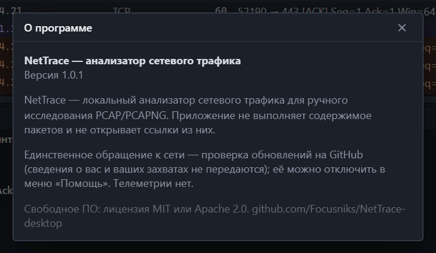

## Коротко

- Захваты обрабатываются только на вашем компьютере.
- Телеметрии, аналитики и отчётов о сбоях нет.
- Единственное обращение к сети — проверка обновлений на GitHub. Её можно отключить.
- Содержимое пакетов не выполняется, ссылки из них не открываются.

*То же самое сказано в окне **Помощь → О программе**.*

## Обращения к сети

| Когда | Куда | Что передаётся |
|---|---|---|
| Проверка обновлений при запуске и по команде | `github.com` — файл `latest.json` последнего релиза | Обычный HTTPS-запрос. Ни сведений о вас, ни данных захватов |
| Загрузка обновления по вашей команде | Страница релиза на GitHub | То же |

Больше программа никуда не обращается. Она не разрешает имена из пакетов, не проверяет адреса по базам, не скачивает ничего по ссылкам из трафика.

Отключить проверку: **Помощь → Проверять обновления при запуске**. После этого NetTrace работает полностью без сети; обновить его можно вручную, скачав установщик.

GitHub, как любой веб-сервер, видит IP-адрес, с которого пришёл запрос.

## Защита обновлений

- Каждый установщик подписан ключом проекта. Программа проверяет подпись перед установкой и отказывается ставить пакет без неё или с неверной.
- Подпись включает номер версии: подсунуть старую версию под видом новой нельзя.
- Сборка релиза идёт в GitHub Actions из открытого кода; ключ подписи доступен только шагу подписи.

Подробности — в разделе [выпуск версий](RELEASING.md).

## Файлы захвата — недоверенные данные

Захват может содержать что угодно, в том числе специально подготовленные данные. Поэтому:

| Мера | Что она даёт |
|---|---|
| Разбор не выполняет данные | Содержимое пакета — только байты для показа |
| Проверка всех длин и смещений | Пакет с ложной длиной не приводит к чтению за пределами |
| Ограничения на вложенность и число записей | Пакет не может заставить программу зависнуть или занять всю память |
| Изоляция сбоя | Ошибка разбора одного пакета помечает его как повреждённый и не роняет программу |
| Экранирование в [содержимом потока](follow.md) | Невидимые и переворачивающие текст символы показываются кодами: данные не могут выглядеть иначе, чем есть |
| Код ядра на Rust без небезопасных блоков | Целый класс ошибок работы с памятью исключён. Исключение — тонкая прослойка к драйверу Npcap |

## Что сохраняется на диске

| Что | Где | Когда удаляется |
|---|---|---|
| Настройки интерфейса | Профиль пользователя Windows | При удалении профиля приложения |
| Недавние файлы | Там же — только пути, до 10 штук | Вытесняются новыми |
| История фильтров | Там же, до 30 выражений | Вытесняются новыми |
| Временный файл живого захвата | `%TEMP%\NetTrace` | При закрытии захвата или программы |
| Сохранённые вами файлы | Где вы указали | Вами |

Если программа аварийно завершилась во время захвата, временный файл остаётся и удаляется при следующем запуске, когда ему больше суток.

> **Важно.** Путь к файлу захвата может сам быть чувствительной информацией. Список недавних файлов виден на стартовом экране.

## Права в системе

- Установка и работа с файлами — без прав администратора.
- Живой захват требует драйвер Npcap. Нужны ли права администратора, зависит от того, как он установлен — см. [установка](install.md).
- Файл для сохранения всегда выбирается в системном диалоге: интерфейс не может записать файл по произвольному пути без вашего участия.

## Что NetTrace видит в захвате

Всё, что передавалось открыто: адреса, имена DNS, заголовки HTTP, имена серверов TLS, а в незашифрованных протоколах — и сами данные, включая пароли и cookie. Относитесь к файлам захвата как к конфиденциальным и не передавайте их без необходимости.

Чтобы поделиться частью захвата, отфильтруйте нужные пакеты и [сохраните](files.md) только их.

## Сообщить об уязвимости

Напишите в [раздел Issues](https://github.com/Focusniks/NetTrace-desktop/issues) репозитория. Если проблема позволяет навредить пользователям, не публикуйте подробности и способ воспроизведения открыто: создайте issue без деталей и попросите закрытый канал связи.
