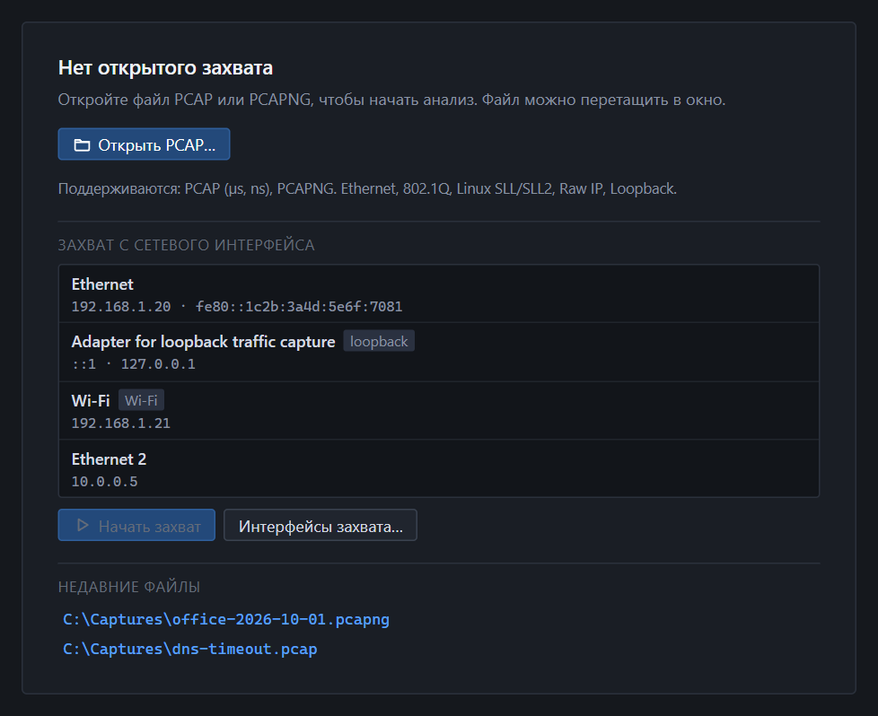
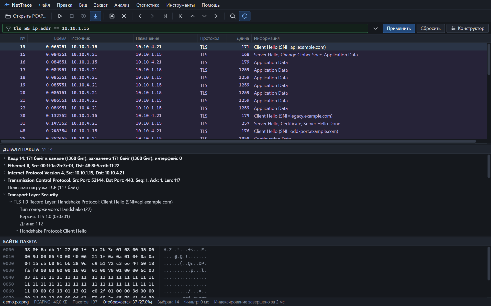

## 1. Откройте захват

- Перетащите файл `.pcap` или `.pcapng` в окно, **или**
- нажмите <kbd>Ctrl</kbd>+<kbd>O</kbd>, **или**
- выберите интерфейс на стартовом экране и нажмите «Начать захват» (нужен [Npcap](install.md)).


*Стартовый экран. Список интерфейсов появляется, если установлен Npcap.*

Пакеты видны сразу, пока файл ещё индексируется. Прогресс показан в строке состояния внизу.

## 2. Посмотрите на пакет

Щёлкните строку в списке. Ниже откроются две панели:

- **Детали пакета** — дерево протоколов от кадра до прикладного уровня;
- **Байты пакета** — hex-дамп. Выбранное в дереве поле подсвечивается в байтах, и наоборот.

Стрелки <kbd>↑</kbd> и <kbd>↓</kbd> переходят между пакетами, <kbd>←</kbd> и <kbd>→</kbd> сворачивают и разворачивают узлы дерева.

## 3. Отфильтруйте лишнее

Введите выражение в строку фильтра и нажмите <kbd>Enter</kbd>:

```text
ip.addr == 10.10.1.15 && tcp.port == 443
```

Быстрее всего — правой кнопкой по ячейке или полю и «Применить как фильтр». Сбросить фильтр — кнопка «Сбросить».


*Фильтр `tls && ip.addr == 10.10.1.15`: отображается 37 пакетов из 137.*

Синтаксис и все операторы — в разделе [фильтры отображения](filters.md), типовые выражения — в [готовых фильтрах](filter-recipes.md).

## 4. Найдите нужное

<kbd>Ctrl</kbd>+<kbd>F</kbd> открывает поиск по строке, hex-байтам, адресу, порту или домену. Найденное поле подсвечивается в дереве и в байтах. Подробнее — [поиск](search.md).

## 5. Перейдите к потоку

Нажмите <kbd>Enter</kbd> на пакете или выберите в контекстном меню «Открыть поток». Справа откроется панель с потоком: участники, объём, RTT, ретрансмиссии.

Оттуда же:

- «Показать пакеты потока» — фильтр по этому потоку;
- «Последовательность» — [лестничная диаграмма](sequence.md);
- «Содержимое» — [данные потока](follow.md) как текст или hex.

## Что дальше

- [Окно программы](interface.md) — где что находится.
- [Потоки и TCP-анализ](streams.md) — как читать счётчики.
- [Сочетания клавиш](shortcuts.md).
