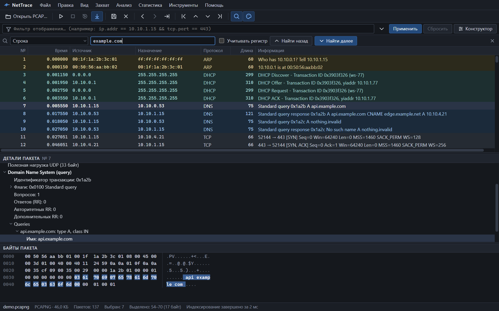

Поиск не скрывает пакеты, как фильтр, а переходит к следующему совпадению. Откройте его клавишами <kbd>Ctrl</kbd>+<kbd>F</kbd>.

*Поиск строки `example.com`: найден DNS-запрос, совпавшее поле подсвечено.*

## Как пользоваться

1. Выберите слева, что ищете.
2. Введите значение.
3. Нажмите <kbd>Enter</kbd> — «Найти далее» или <kbd>Shift</kbd>+<kbd>Enter</kbd> — «Найти назад».

Поиск идёт от выбранного пакета. Дойдя до конца, он продолжает с начала и сообщает: «Поиск продолжен с начала». <kbd>Esc</kbd> закрывает панель.

Поиск работает по отображаемым пакетам: если применён [фильтр](filters.md), ищется только среди прошедших его.

## Виды поиска

| Вид | Что ищет | Пример |
|---|---|---|
| Строка | Текст в байтах пакета и в разобранных полях: именах DNS, HTTP Host, TLS SNI | `example.com` |
| Hex-байты | Последовательность байт в любом месте пакета | `16 03 01` или `160301` |
| Фильтр | Следующий пакет, подходящий под выражение фильтра | `tcp.flags.reset == 1` |
| IP-адрес | Адрес источника или назначения, IPv4 или IPv6 | `10.10.4.21` |
| MAC-адрес | Адрес источника или назначения | `00:1f:1a:2b:3c:01` |
| Порт | Порт TCP или UDP | `443` |
| Протокол | Пакеты протокола | `dns` |
| Номер пакета | Переход к пакету с этим номером | `1024` |
| Домен (DNS / SNI / Host) | Имя в DNS-запросе, TLS SNI или HTTP Host | `example` |
| HTTP Host | Заголовок Host | `api.example.com` |
| TLS SNI | Имя сервера в ClientHello | `example.com` |

Для строки есть флажок «Учитывать регистр». Без него `Example` и `example` — одно и то же.

## Что подсвечивается

Когда совпадение найдено, NetTrace показывает, где именно оно в пакете:

- в дереве выбирается и раскрывается совпавшее поле;
- в hex-дампе подсвечиваются совпавшие байты.

Для поиска по фильтру подсвечивается поле, из-за которого пакет подошёл. Условия с отрицанием (`!`, `!=`) на поле не указывают: пакет подошёл как раз потому, что такого значения в нём нет.

## Поиск или фильтр

| Задача | Что использовать |
|---|---|
| Оставить в списке только нужные пакеты | [Фильтр](filters.md) |
| Пройти по совпадениям, не теряя соседние пакеты | Поиск |
| Найти байты, для которых нет поля | Поиск по hex или строке |
| Быстро перейти к пакету по номеру | <kbd>Ctrl</kbd>+<kbd>G</kbd> |

Те же виды поиска можно записать фильтром:

| Вид | Эквивалентный фильтр |
|---|---|
| IP-адрес | `ip.addr == 10.10.4.21` |
| MAC-адрес | `eth.addr == 00:1f:1a:2b:3c:01` |
| Порт | `tcp.port == 443 or udp.port == 443` |
| Домен | `dns.qry.name contains "example" or tls.handshake.extensions_server_name contains "example" or http.host contains "example"` |
