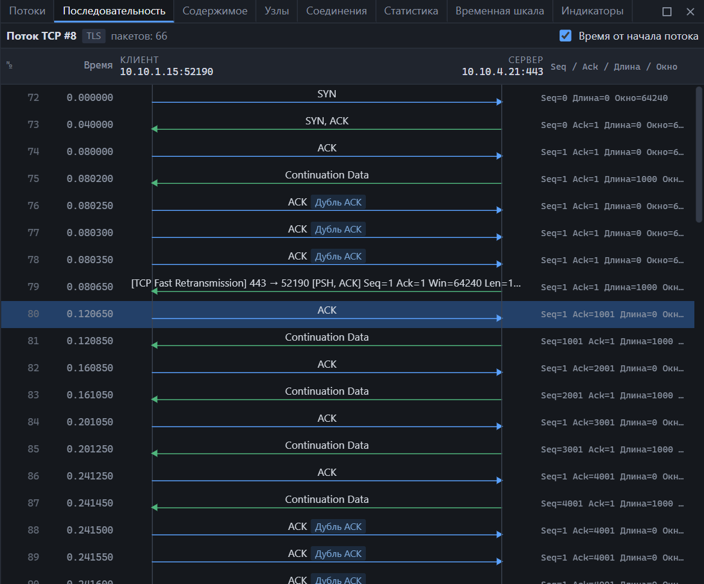

*Стрелка вправо — от клиента к серверу, влево — от сервера к клиенту.*

## Открыть

- Контекстное меню пакета → «Последовательность потока»;
- кнопка «Последовательность» в карточке [потока](streams.md);
- **Анализ → Последовательность потока**.

## Как читать

Каждая строка — один пакет потока:

| Колонка | Значение |
|---|---|
| № | Номер пакета в захвате |
| Время | От начала потока или от начала захвата |
| Стрелка | Направление: синяя — от клиента, зелёная — от сервера |
| Подпись над стрелкой | Флаги TCP или краткое описание прикладного сообщения |
| Seq / Ack / Длина / Окно | Номера последовательности и подтверждения, длина данных, окно получателя |

Слева вверху — адрес и порт клиента, справа — сервера.

Номера Seq и Ack относительные: отсчёт идёт от начала соединения, как в списке пакетов.

## Значки проблем

Рядом с подписью появляются значки [анализа TCP](streams.md):

| Значок | Пометка |
|---|---|
| Ретр. | Повторная передача |
| Быстрая ретр. | Быстрая повторная передача |
| Не по порядку | Сегмент не по порядку |
| Дубль ACK | Дубликат ACK |
| Потеря | Предыдущий сегмент не захвачен |
| Нулевое окно | Получатель объявил окно 0 |
| Keep-alive | Проверка соединения |
| Изм. окна | Обновление окна |

## Управление

| Действие | Как |
|---|---|
| Перейти к пакету в списке | Щелчок по строке |
| Сменить отсчёт времени | Флажок «Время от начала потока» |
| Подробности пакета | Наведите на строку — подсказка покажет всё целиком |

Выбранный в списке пакет подсвечивается и на диаграмме.

## Что видно на диаграмме

| Картина | Что это |
|---|---|
| SYN → SYN, ACK → ACK | Нормальное рукопожатие |
| SYN → RST, ACK | Порт закрыт |
| Несколько SYN подряд без ответа | Сервер не отвечает или пакеты теряются |
| Данные, затем серия «Дубль ACK» и «Быстрая ретр.» | Потеря сегмента и восстановление |
| Длинная пауза перед ответом сервера | Сервер долго обрабатывал запрос |
| «Нулевое окно» от получателя | Получатель не успевает читать |
| FIN с обеих сторон | Штатное закрытие |
| RST посреди обмена | Соединение оборвано |

## Длинные потоки

Диаграмма подгружает строки по мере прокрутки, поэтому работает и на потоках в миллионы пакетов. Во время живого захвата она дополняется каждые две секунды.

Диаграмма строится и для UDP-потоков — без флагов и номеров последовательности.
