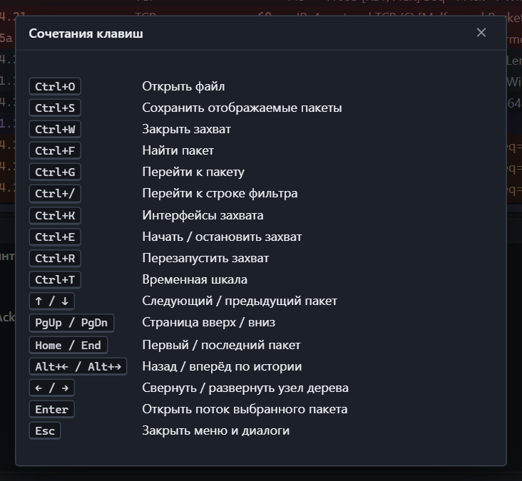

## Файл и захват

| Клавиши | Действие |
|---|---|
| <kbd>Ctrl</kbd>+<kbd>O</kbd> | Открыть файл |
| <kbd>Ctrl</kbd>+<kbd>S</kbd> | Сохранить отображаемые пакеты |
| <kbd>Ctrl</kbd>+<kbd>W</kbd> | Закрыть захват |
| <kbd>Ctrl</kbd>+<kbd>K</kbd> | Интерфейсы захвата |
| <kbd>Ctrl</kbd>+<kbd>E</kbd> | Начать или остановить захват |
| <kbd>Ctrl</kbd>+<kbd>R</kbd> | Перезапустить захват |

## Поиск и фильтр

| Клавиши | Действие |
|---|---|
| <kbd>Ctrl</kbd>+<kbd>F</kbd> | Найти пакет |
| <kbd>Enter</kbd> в поиске | Найти далее |
| <kbd>Shift</kbd>+<kbd>Enter</kbd> в поиске | Найти назад |
| <kbd>Ctrl</kbd>+<kbd>G</kbd> | Перейти к пакету по номеру |
| <kbd>Ctrl</kbd>+<kbd>/</kbd> | Перейти в строку фильтра |
| <kbd>Enter</kbd> в строке фильтра | Применить фильтр |
| <kbd>Tab</kbd> в строке фильтра | Принять подсказку |

## Список пакетов

| Клавиши | Действие |
|---|---|
| <kbd>↑</kbd> / <kbd>↓</kbd> | Предыдущий и следующий пакет |
| <kbd>PgUp</kbd> / <kbd>PgDn</kbd> | Страница вверх и вниз |
| <kbd>Home</kbd> / <kbd>End</kbd> | Первый и последний пакет |
| <kbd>Ctrl</kbd>+<kbd>Home</kbd> / <kbd>Ctrl</kbd>+<kbd>End</kbd> | То же из любой области окна |
| <kbd>Alt</kbd>+<kbd>←</kbd> / <kbd>Alt</kbd>+<kbd>→</kbd> | Назад и вперёд по истории выбора |
| <kbd>Enter</kbd> | Открыть поток выбранного пакета |
| <kbd>Shift</kbd>+<kbd>F10</kbd> | Контекстное меню |

## Дерево деталей

| Клавиши | Действие |
|---|---|
| <kbd>↑</kbd> / <kbd>↓</kbd> | Предыдущее и следующее поле |
| <kbd>→</kbd> | Развернуть узел |
| <kbd>←</kbd> | Свернуть узел |

## Панели и окна

| Клавиши | Действие |
|---|---|
| <kbd>Ctrl</kbd>+<kbd>T</kbd> | Временная шкала |
| <kbd>F1</kbd> | Сочетания клавиш |
| <kbd>Esc</kbd> | Закрыть меню, диалог или поиск |

## Мышь

| Действие | Результат |
|---|---|
| Двойной щелчок по пакету | Открыть его поток |
| Правая кнопка по ячейке или полю | Контекстное меню с фильтрами и копированием |
| Правая кнопка по заголовку списка | Меню колонок |
| Двойной щелчок по строке таблицы потоков, узлов, соединений | Фильтр по этой строке |
| Выделение на графике или шкале | Фильтр по времени |
| Колесо мыши над вкладками боковой панели | Прокрутка вкладок |
