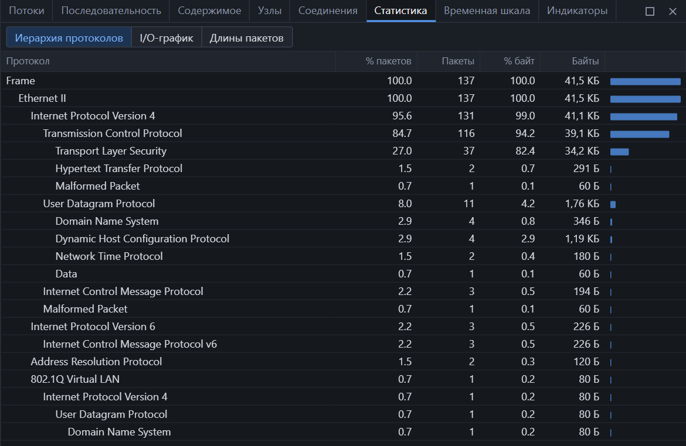
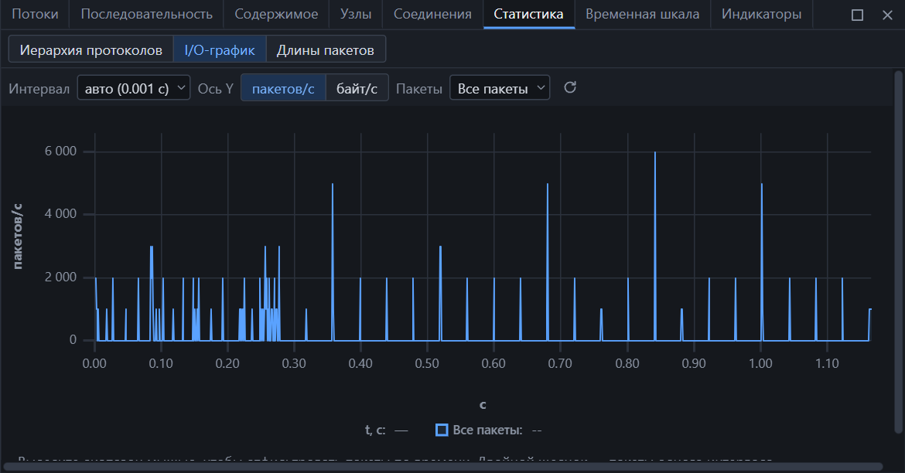
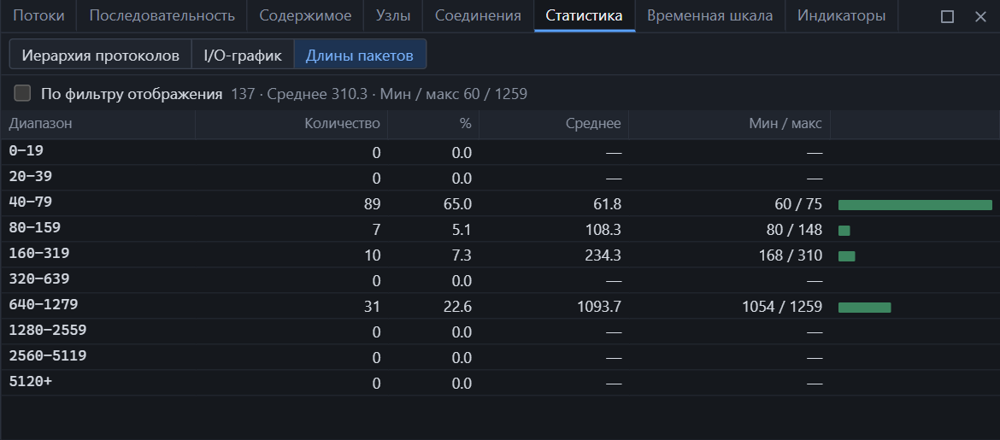

Панель открывается из меню **Статистика**. Вверху — три вкладки.

## Иерархия протоколов

Дерево показывает, из каких протоколов состоит захват и как они вложены друг в друга.

| Колонка | Значение |
|---|---|
| Протокол | Узел дерева: внутри Ethernet — IPv4, внутри IPv4 — TCP и так далее |
| % пакетов, Пакеты | Доля и число пакетов, содержащих этот протокол |
| % байт, Байты | Доля и объём этих пакетов |
| Полоса | Доля по байтам наглядно |

Проценты считаются от всего захвата. Сумма по дочерним узлам может быть меньше родителя: часть пакетов заканчивается на родительском протоколе — например, TCP-сегменты без данных.

| Действие | Как |
|---|---|
| Показать пакеты протокола | Двойной щелчок |
| Добавить к фильтру или исключить | Контекстное меню |

Что стоит заметить:

- **Malformed Packet** — пакеты, которые не разобрались до конца;
- **Data** — данные, для которых нет диссектора;
- один и тот же протокол в разных ветках — например, DNS внутри VLAN — это разные пути вложенности.

## I/O-график

График интенсивности трафика по времени.

| Параметр | Значения |
|---|---|
| Интервал | Авто или 0,001 / 0,01 / 0,1 / 1 / 10 / 60 секунд |
| Ось Y | Пакетов в секунду или байт в секунду |
| Пакеты | Что рисовать — см. ниже |

Источник пакетов для графика:

| Вариант | Что рисуется |
|---|---|
| Все пакеты | Весь захват |
| По фильтру отображения | Только пакеты, прошедшие текущий фильтр |
| Протокол | Пакеты выбранного протокола |
| Поток | Один TCP- или UDP-поток |
| Свой фильтр | Любое выражение [фильтра](filters.md) |

Работа с графиком:

| Действие | Результат |
|---|---|
| Выделить диапазон мышью | К фильтру добавляется условие по времени — остаются пакеты этого отрезка |
| Двойной щелчок по столбцу | Пакеты одного интервала |
| Навести указатель | Время и значение в этой точке |
| Кнопка обновления | Пересчитать, например во время захвата |

В режиме «авто» интервал подбирается так, чтобы на графике было не больше 1500 точек.

## Длины пакетов

Сколько пакетов попало в каждый диапазон длин.

| Колонка | Значение |
|---|---|
| Диапазон | Длина кадра в байтах |
| Количество, % | Число пакетов и доля |
| Среднее | Средняя длина в диапазоне |
| Мин / макс | Самый короткий и самый длинный пакет диапазона |

Флажок **«По фильтру отображения»** считает распределение только по пакетам, прошедшим фильтр. Двойной щелчок по строке показывает пакеты этого диапазона.

Как читать распределение:

| Картина | Обычно означает |
|---|---|
| Пик на 40–79 | Подтверждения TCP, запросы DNS, управляющие пакеты |
| Пик на 1280–2559 | Передача данных полными сегментами |
| Только мелкие пакеты | Интерактивный или управляющий трафик |
| Пакеты больше 1514 | Захват сделан до сегментации сетевой картой или сеть с jumbo-кадрами |

## Свойства захвата

Сводные числа по всему захвату — **Статистика → Свойства захвата**, см. [окно программы](interface.md).
