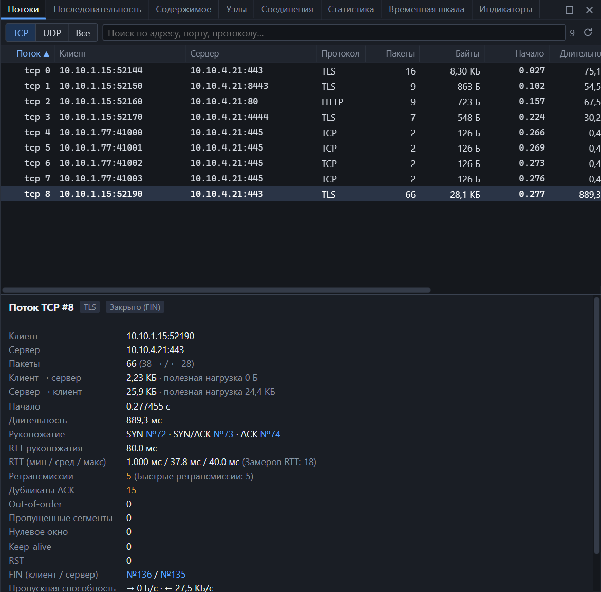

**Поток** — все пакеты между двумя парами «адрес и порт»: `10.10.1.15:52190 ↔ 10.10.4.21:443`. Потоки нумеруются с нуля отдельно для TCP и UDP в порядке появления.

*Вверху — все потоки, внизу — карточка выбранного.*

## Открыть панель

- <kbd>Enter</kbd> или двойной щелчок на пакете — откроется поток этого пакета;
- контекстное меню пакета → «Открыть поток»;
- **Статистика → Потоки**.

## Таблица потоков

| Колонка | Значение |
|---|---|
| Поток | Тип и номер: `tcp 8` |
| Клиент | Кто начал соединение: адрес и порт |
| Сервер | Кому адресовано |
| Протокол | Прикладной протокол: TLS, HTTP, DNS… |
| Пакеты, Байты | Объём в обе стороны |
| Начало | Время первого пакета от начала захвата, секунды |
| Длительность | От первого до последнего пакета |
| Ретр. | Число повторных передач (только TCP) |
| RTT | Среднее время подтверждения (только TCP) |
| Состояние | Чем закончилось соединение (только TCP) |

Над таблицей — переключатель **TCP / UDP / Все** и поиск по адресу, порту или протоколу. Сортировка — щелчком по заголовку.

| Действие | Как |
|---|---|
| Показать карточку потока | Щелчок по строке |
| Отфильтровать пакеты потока | Двойной щелчок или <kbd>Enter</kbd> |
| Содержимое, последовательность, первый и последний пакет | Контекстное меню или кнопки в карточке |

Клиентом считается сторона, отправившая первый SYN. Если начало соединения не захвачено — сторона первого увиденного пакета.

## Карточка потока

| Строка | Значение |
|---|---|
| Клиент, Сервер | Адреса и порты сторон |
| Пакеты | Всего и по направлениям: `66 (38 → / ← 28)` |
| Клиент → сервер, Сервер → клиент | Байты на проводе и отдельно полезная нагрузка — без заголовков |
| Начало, Длительность | Время первого пакета и длина потока |
| Рукопожатие | Номера пакетов SYN, SYN/ACK и ACK — по ним можно щёлкнуть |
| RTT рукопожатия | Время от SYN до завершающего ACK |
| RTT (мин / сред / макс) | Время от сегмента данных до его подтверждения |
| Ретрансмиссии | Повторные передачи; в скобках — сколько из них быстрых |
| Дубликаты ACK, Out-of-order, Пропущенные сегменты, Нулевое окно, Keep-alive | Счётчики пометок анализа |
| RST | Число пакетов сброса |
| FIN (клиент / сервер) | Номера пакетов с FIN каждой стороны |
| Пропускная способность | Средняя скорость по направлениям |

Кнопки под карточкой:

- **Показать пакеты потока** — фильтр `tcp.stream == N`;
- **Содержимое** — [данные потока](follow.md);
- **Последовательность** — [лестничная диаграмма](sequence.md);
- **Первый пакет**, **Последний пакет** — переход к ним в списке.

## Состояния TCP-соединения

| Состояние | Что произошло |
|---|---|
| SYN отправлен, ответа нет | Клиент послал SYN, сервер не ответил |
| SYN/ACK получен | Сервер ответил, но завершающий ACK не захвачен |
| Установлено | Рукопожатие завершено, соединение не закрыто |
| Начало не захвачено | Захват начался, когда соединение уже шло |
| Закрывается (FIN) | FIN прошёл в одну сторону |
| Закрыто (FIN) | FIN прошёл в обе стороны — штатное завершение |
| Сброшено (RST) | Соединение оборвано пакетом RST |
| Отклонено (RST на SYN) | Сервер ответил RST на SYN: порт закрыт или соединение запрещено |

## Пометки анализа TCP

NetTrace отслеживает номера последовательности в каждом направлении и помечает пакеты, которые отклоняются от нормального обмена. Пометки видны в дереве пакета в узле «Анализ SEQ/ACK», в списке — цветом, на диаграмме — значками.

| Пометка | Когда ставится | О чём говорит | Фильтр |
|---|---|---|---|
| Повторная передача | Сегмент с данными, которые уже передавались | Потеря пакета или его подтверждения | `tcp.analysis.retransmission` |
| Быстрая повторная передача | Повтор после двух и более дубликатов ACK, не дожидаясь таймера | Одиночная потеря, быстрое восстановление | `tcp.analysis.fast_retransmission` |
| Сегмент не по порядку | Сегмент заполняет пропуск в течение 3 мс после более позднего | Пакеты пришли разными путями или переставлены сетью | `tcp.analysis.out_of_order` |
| Дубликат ACK | Повторный ACK с тем же номером, без данных и без изменения окна | Получатель видит пропуск и просит повторить | `tcp.analysis.duplicate_ack` |
| Предыдущий сегмент не захвачен | Номер последовательности перескочил вперёд | Потеря в сети или пропуск в самом захвате | `tcp.analysis.lost_segment` |
| Подтверждён незахваченный сегмент | ACK на данные, которых в захвате нет | Захват неполный: пакеты были, но не записаны | `tcp.analysis.ack_lost_segment` |
| Нулевое окно | Получатель объявил окно 0 | Приложение не успевает читать данные | `tcp.analysis.zero_window` |
| Обновление окна | ACK, изменивший только размер окна | Обычное событие, не проблема | `tcp.analysis.window_update` |
| Keep-alive | Сегмент в 0 или 1 байт с номером на единицу меньше ожидаемого | Проверка, что соединение живо; не проблема | `tcp.analysis.keep_alive` |
| Повторное использование портов | Новый SYN на той же паре адресов и портов | Началось новое соединение; оно получает свой номер потока | `tcp.analysis.reused_ports` |

Все пометки сразу — `tcp.analysis.flags`.

### Как отличить потерю в сети от неполного захвата

| Признак | Скорее всего |
|---|---|
| «Сегмент не захвачен», затем повторная передача тех же данных | Потеря в сети |
| «Сегмент не захвачен», повторов нет, обмен продолжается | Пакет дошёл, но не попал в захват |
| «Подтверждён незахваченный сегмент» | Захват неполный |
| Много дубликатов ACK и быстрых повторов | Потери на пути от отправителя |

## Как считается RTT

- **RTT рукопожатия** — время от SYN клиента до ACK, завершающего рукопожатие. Это задержка туда и обратно между точкой захвата и обеими сторонами.
- **RTT** — время от сегмента с данными до подтверждающего его ACK. Сегменты, которые передавались повторно, в расчёт не идут: неясно, какую из копий подтвердили.

Точка захвата важна. Если захват сделан на клиенте, RTT клиентских данных — это полная задержка сети, а RTT серверных данных близок к нулю: это лишь время реакции самого клиента.

RTT отдельного пакета — поле `tcp.analysis.ack_rtt` в его дереве.

## UDP-потоки

У UDP нет соединений, поэтому в карточке только участники, объём, время и протокол. Потоком считаются все датаграммы между одной парой адресов и портов.

## Потоки во время живого захвата

Таблица и карточка обновляются сами. Поток, по которому пять минут не было пакетов, теряет часть служебного состояния анализа ради экономии памяти: уже посчитанные счётчики сохраняются, но первый замер RTT после долгой паузы может быть пропущен.
