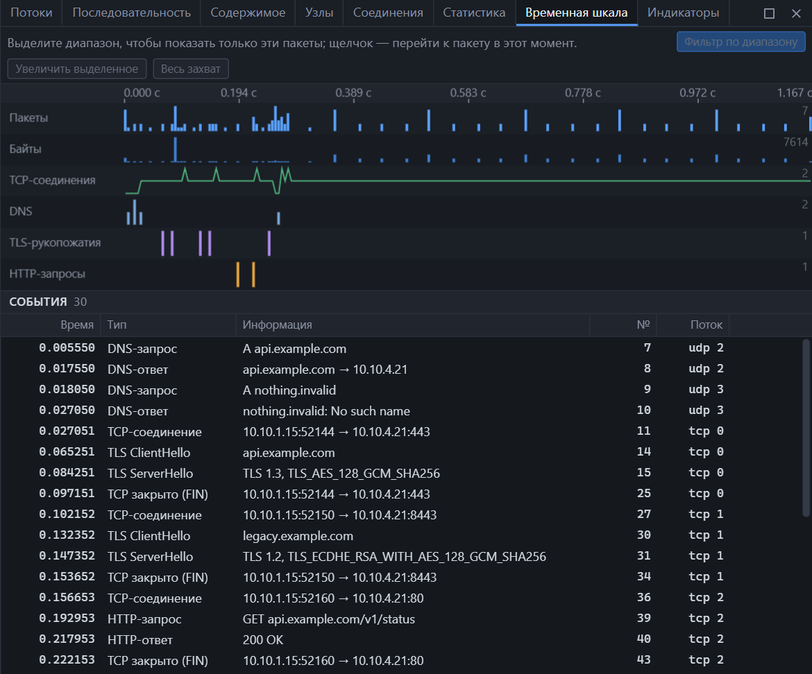

Открывается клавишами <kbd>Ctrl</kbd>+<kbd>T</kbd> или из меню **Вид → Временная шкала**.

*Вверху — дорожки, внизу — события выбранного отрезка.*

## Дорожки

| Дорожка | Что показывает |
|---|---|
| Пакеты | Число пакетов в каждом интервале |
| Байты | Объём в каждом интервале |
| TCP-соединения | Сколько соединений открыто одновременно |
| DNS | Запросы и ответы DNS |
| TLS-рукопожатия | ClientHello и ServerHello |
| HTTP-запросы | Запросы HTTP |

Справа от каждой дорожки — её максимум на видимом отрезке.

## Работа со шкалой

| Действие | Результат |
|---|---|
| Щелчок | Переход к пакету в этот момент времени |
| Выделение диапазона мышью | Диапазон выбран; ниже показаны его события |
| «Увеличить выделенное» | Шкала растягивается на выбранный диапазон |
| «Весь захват» | Вернуть полный масштаб |
| «Фильтр по диапазону» | Оставить в списке только пакеты этого отрезка |

Фильтр по диапазону — это обычное выражение `frame.time_relative >= … && frame.time_relative <= …`, которое добавляется к текущему фильтру.

## События

Под дорожками — таблица событий выбранного отрезка:

| Колонка | Значение |
|---|---|
| Время | От начала захвата, секунды |
| Тип | Вид события |
| Информация | Имя, адрес, код ответа |
| № | Номер пакета |
| Поток | Поток, к которому относится событие |

| Тип события | Информация |
|---|---|
| DNS-запрос | Тип и имя: `A api.example.com` |
| DNS-ответ | Имя и результат: адрес или ошибка |
| TCP-соединение | Клиент → сервер |
| TLS ClientHello | Имя сервера (SNI) |
| TLS ServerHello | Версия и набор шифров |
| HTTP-запрос | Метод, хост и путь |
| HTTP-ответ | Код и фраза состояния |
| TCP закрыто (FIN) | Участники |
| TCP сброшено (RST) | Участники |

Щелчок по событию переходит к его пакету.

Если событий на отрезке слишком много, таблица показывает первые и предлагает уменьшить диапазон.

## Что удобно искать на шкале

| Задача | Как |
|---|---|
| Когда началась проблема | Найдите всплеск или провал на дорожке «Пакеты» и выделите его |
| Что происходило перед сбоем | Выделите отрезок перед событием «TCP сброшено» |
| Порядок действий клиента | Читайте события подряд: DNS-запрос → TCP-соединение → TLS ClientHello → HTTP-запрос |
| Медленный ответ | Сравните время HTTP-запроса и HTTP-ответа одного потока |
| Сколько соединений держит клиент | Дорожка «TCP-соединения» |

## Отличие от I/O-графика

| | Временная шкала | [I/O-график](statistics.md) |
|---|---|---|
| Назначение | Обзор захвата и событий | Точное измерение нагрузки |
| Что рисует | Шесть дорожек сразу | Один ряд: пакеты или байты в секунду |
| Фильтр источника | Нет, всегда весь захват | Есть: протокол, поток, свой фильтр |
| События | Есть | Нет |
